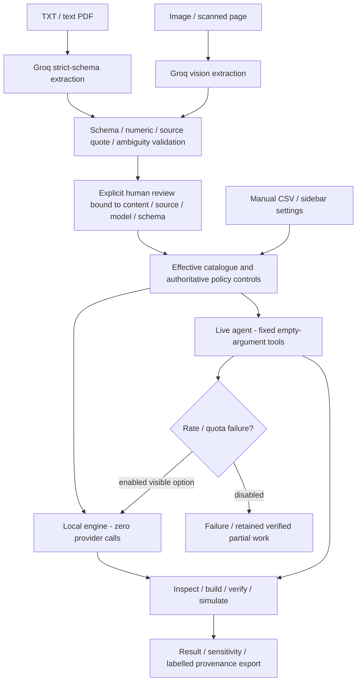

# Architecture

## Components and decisions

- app.py: validates CSV/settings, applies source-bound reviewed evidence, handles disruptions, selects the explicit route and exports actual status.
- agent.py: bounded Groq requests, fixed inspect_catalogue/build_plan/validate_plan/simulate_plan tools, strict text schema and existing vision extraction. Generated tool arguments cannot override authoritative controls. Goals coordinate tool execution; sidebar/reviewed policy control numerical calculations.
- workflow.py: review hashes, local workflow, distinct quota fallback. Source/model/schema/value changes require review again. Cached extraction never grants review; evaluation bypasses caching.
- engine.py: feasible discount/duration/mechanism candidates, complementary-pair bundles and greedy portfolio. Checks component stock/margin, total advertising budget, discount cap, quantities and overlap. Simulation compares the same selected products with a no-promotion baseline under assumed demand factors.

Policy non-null limits override corresponding sidebar settings; null optional values retain settings. Budget disruption follows policy application. Unknown/duplicate SKUs, invalid values, conflicts or missing-required facts block evidence application. TXT/text-PDF quotes are checked against source text; image quotes require visual human review. Synthetic disclosures are warnings, not permission to ignore genuine conflicts.

Strict schema compliance is not factual correctness. Provider/model access is configurable; no automatic provider substitution occurs. Service retries are bounded, deadlines shared, quota errors stop provider work. Enabled planning quota fallback executes locally and records failed live attempt, ai_workflow_completed=false and any verified partial result. Extraction is never replaced with fixture answers. Incomplete AI workflows are not called successful.

Exports retain effective controls/catalogue, source filename/hash, quotes/dates/warnings, extraction model/schema, review binding, trace, actual route and status. No campaigns launch. Keys remain local/environment and excluded by .gitignore. Demand is synthetic/assumed, selection heuristic; no production SLA or global-optimality claim.
